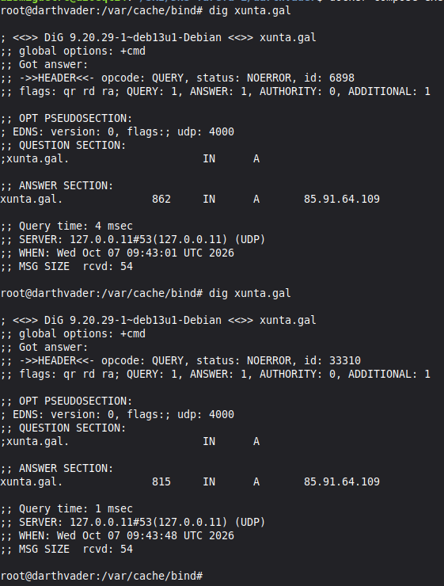
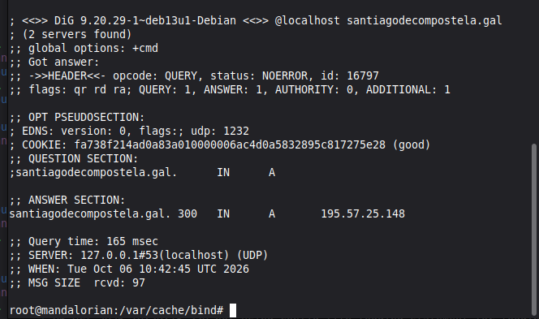

1. Instala o servidor BIND9 no equipo darthvader. Comproba que xa funciona coma servidor DNS caché pegando no documento de entrega a saída deste comando dig @localhost xunta.gal 

2. Configura o servidor BIND9 no equipo mandalorian para que empregue como reenviador a darthvader pegando no documento de entrega contido do ficheiro /etc/bind/named.conf.options e a saída deste comando: dig @localhost santiagodecompostela.gal.
Contido do ficheiro named.conf.options:

options {
	directory "/var/cache/bind";

	// If there is a firewall between you and nameservers you want
	// to talk to, you may need to fix the firewall to allow multiple
	// ports to talk.  See http://www.kb.cert.org/vuls/id/800113

	// If your ISP provided one or more IP addresses for stable 
	// nameservers, you probably want to use them as forwarders.  
	// Uncomment the following block, and insert the addresses replacing 
	// the all-0s placeholder.

	forwarders {
	    192.168.20.10;
	};

	//========================================================================
	// If BIND logs error messages about the root key being expired,
	// you will need to update your keys.  See https://www.isc.org/bind-keys
	//========================================================================
	dnssec-validation auto;

	auth-nxdomain no;    # conform to RFC1035
	listen-on-v6 { any; };
};

